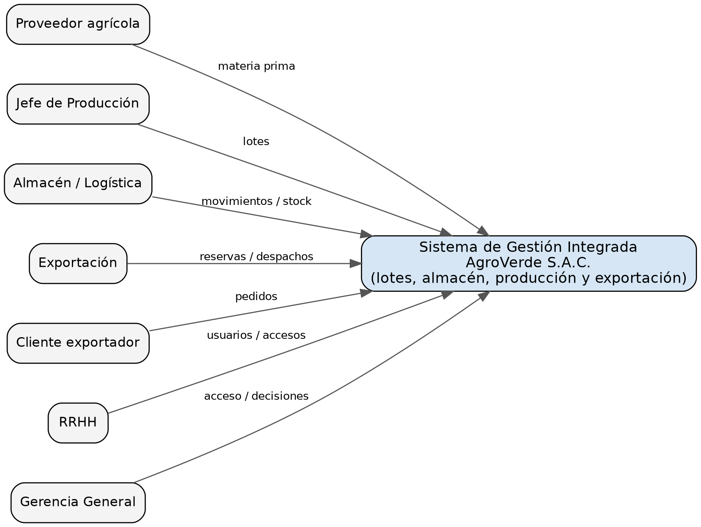
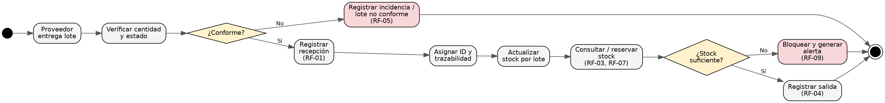

# Tema 1: Catálogo de requisitos (RF/RNF) y trazabilidad requisito–fase
 Gestión digital de almacén y trazabilidad de lotes de AgroVerde S.A.C.
 https://github.com/Cris0cl12/LABORATORIO-1-Des.app-CIIN1322P


## 2. Procedimiento y evidencias

### 2.1 Caso de estudio (Paso 1)
- **Organización:** AgroVerde S.A.C., agroindustrial en La Libertad (espárrago, palta y arándano para exportación); 47 trabajadores y 3 líneas de producción.
- **Problema:** el control se apoya en hojas de cálculo; no hay trazabilidad completa de lotes, el stock de almacén no coincide con los pedidos de exportación y los datos personales carecen de controles de acceso suficientes.
- **Dentro del alcance:** productos y lotes, recepción, entradas, salidas, transferencias, ajustes, stock por lote, trazabilidad, reservas para exportación, alertas, reportes, usuarios, roles y bitácora.
- **Fuera del alcance:** planificación detallada de producción, contabilidad, planillas, CRM, comercio electrónico, mantenimiento de maquinaria, transporte internacional, analítica avanzada.
- **Fuente:** expediente RUP-UML de AgroVerde S.A.C. (Desafío final CIIN1322P), sección 1.

### 2.2 Stakeholders, objetivos y restricciones (Paso 2)
| Stakeholder | Rol | Interés | Objetivo de negocio |
|---|---|---|---|
| Gerencia General | Aprueba alcance, presupuesto y prioridades | Alto | Controlar costos y contar con reportes confiables |
| Jefe de Producción | Coordina líneas y lotes | Alto | Lotes generados y trazados correctamente |
| Almacén / Logística | Registra recepciones, stock y salidas | Alto | Stock confiable y sin diferencias |
| Exportación | Gestiona pedidos, reservas y despachos | Alto | Cumplir pedidos sin doble compromiso de stock |
| RRHH | Custodia datos y accesos | Medio | Proteger datos personales (Ley N.° 29733) |
| Operario | Registros y consultas autorizadas | Alto | Registrar rápido con interfaz simple |
| Proveedor agrícola | Entrega materia prima identificada | Medio | Recepción ágil e identificada |
| Cliente exportador | Origina pedidos y recibe lotes | Medio | Recibir lotes con origen verificable |

| Dimensión | Restricción | Meta |
|---|---|---|
| Legal | Cumplir Ley N.° 29733; acceso por autenticación y rol | 100 % de accesos a datos personales autenticados y autorizados |
| Social | Interfaz simple (alfabetización digital básica) | 60 % de operarios con alfabetización digital básica |
| Económica | Evitar infraestructura costosa | Presupuesto máximo S/ 80,000 |
| Técnica | Infraestructura básica y conectividad limitada | Integrar 3 líneas de producción y almacén |
| Ambiental | Reducir formularios en papel | Reducir al menos 50 % de formatos en papel |

**Criterios de éxito:** CE-01 trazabilidad del 100 % de movimientos (lote, fecha, origen/destino, responsable); CE-02 95 % de consultas de stock en ≤ 3 s; CE-03 100 % de accesos sensibles autenticados; CE-04 toda diferencia de stock genera incidencia; CE-05 usuario con alfabetización básica completa recepción o salida tras capacitación breve.

### 2.3 Elicitación y hallazgos (Paso 3)
| Técnica | Fuente / instrumento | Resultado |
|---|---|---|
| Análisis documental | Expediente RUP-UML (visión, dominio, SRS) | Hallazgos H-01 a H-05 |
| Entrevista estructurada | Guion para Almacén y Exportación (ver abajo) | Valida H-01, H-02 y H-03 |
| Encuesta breve | Cuestionario de 5 ítems para operarios (ver abajo) | Valida H-04 y H-05 |
| Prototipo | Boceto de pantalla de recepción (UC01) | Valida RF-01 y RNF-05 |

| ID | Hallazgo | Requisito derivado |
|---|---|---|
| H-01 | Los lotes se controlan en hojas de cálculo y no hay historial completo | RF-01, RF-08 |
| H-02 | El stock de almacén no coincide con los pedidos de exportación | RF-07, RF-09 |
| H-03 | Hay datos personales sin control de acceso | RF-11, RF-12, RNF-01 |
| H-04 | Conectividad limitada en planta | RNF-04 |
| H-05 | Operarios con alfabetización digital básica | RNF-05 |

**Guion de entrevista:** (1) ¿Cómo registra hoy una recepción de lote? (2) ¿Qué datos son obligatorios? (3) ¿Qué errores o diferencias de stock ocurren y cada cuánto? (4) ¿Cuánto tarda hoy una consulta de stock? (5) ¿Quién accede a datos del personal y cómo?

**Cuestionario:** (1) ¿Usa hojas de cálculo para registrar lotes? (2) ¿Ha tenido diferencias de stock? (3) ¿La conectividad en planta es estable? (4) ¿Cómo califica su manejo de computadora (1 a 5)? (5) ¿Qué le facilitaría más el registro?

**Prototipo (UC01 Registrar recepción):**
```
+--------------------------------------+
| REGISTRAR RECEPCIÓN                  |
| Producto:   [ Palta Hass        v ]  |
| Proveedor:  [ Agrícola ______   v ]  |
| Cantidad:   [ ______ ] kg           |
| Código/fecha: autogenerados          |
| [ Cancelar ]            [ Confirmar ]|
+--------------------------------------+
```

### 2.4 Catálogo RF/RNF con criterios de aceptación (Pasos 4 y 5)
| ID | Requisito | MoSCoW | Criterio de aceptación |
|---|---|---|---|
| RF-01 | Registrar lotes recibidos con producto, cantidad, fecha, proveedor y código | Must | Crea lote, actualiza existencias y registra usuario/fecha |
| RF-02 | Registrar ubicación y movimientos internos del lote | Must | Conserva ubicación anterior/nueva, fecha y responsable |
| RF-03 | Consultar stock por producto, lote, estado y ubicación | Must | Devuelve existencias vigentes y estado |
| RF-04 | Registrar salida hacia producción o exportación | Must | Descuenta stock y asocia destino, cantidad y responsable |
| RF-05 | Registrar lotes observados, rechazados o no conformes | Must | Los separa del stock disponible hasta su resolución |
| RF-06 | Registrar ajustes de inventario | Must | No aplica ajuste sin autorización, motivo y auditoría |
| RF-07 | Reservar existencias para pedidos de exportación | Must | Impide comprometer dos veces la misma cantidad |
| RF-08 | Consultar historial completo de trazabilidad | Must | Muestra origen, movimientos, estados y salida final |
| RF-09 | Generar alertas por stock insuficiente, diferencia o lote incompleto | Should | Identifica lote/producto, causa, fecha y responsable |
| RF-10 | Generar reportes de entradas, salidas, stock y diferencias | Should | Permite filtrar y exportar según permisos |
| RF-11 | Administrar usuarios y roles por área | Must | Solo usuario autorizado asigna o retira permisos |
| RF-12 | Registrar bitácora de accesos y operaciones sensibles | Must | Conserva usuario, fecha, acción y elemento afectado |

| ID | Categoría | Requisito | Criterio de aceptación |
|---|---|---|---|
| RNF-01 | Seguridad / Privacidad | Proteger datos personales con autenticación, roles y mínimo privilegio | 100 % de accesos sensibles con usuario autenticado y permiso vigente |
| RNF-02 | Rendimiento | Responder consultas de stock y trazabilidad en infraestructura básica | 95 % de consultas en ≤ 3 s bajo carga objetivo |
| RNF-03 | Disponibilidad | Mantener servicio en horario operativo | Disponibilidad mínima de 98 %, excluyendo mantenimiento planificado |
| RNF-04 | Resiliencia | Tolerar cortes temporales de conectividad | Registro esencial en cola local; sincroniza sin duplicación |
| RNF-05 | Usabilidad | Facilitar el uso a personal con alfabetización digital básica | Usuario nuevo completa recepción o salida tras capacitación breve |

### 2.5 Checklist de calidad aplicado (Paso 5)
| Criterio | Cumple | Observación |
|---|---|---|
| Necesario | Sí | Cada requisito responde a un hallazgo o criterio de éxito |
| No ambiguo | Sí | Verbos observables y criterios medibles |
| Verificable | Sí | Todos tienen criterio de aceptación; RNF-03 requiere herramienta de medición |
| Completo | Parcial | Falta requisito de respaldo/recuperación y de consentimiento de datos personales |
| Consistente | Sí | RF-05 es coherente con RF-04 (solo sale stock disponible) |
| Factible | Sí | RNF ajustados a infraestructura básica y presupuesto de S/ 80,000 |
| Priorizado | Sí | Todos tienen MoSCoW |
| Trazable | Sí | Ver matriz 2.8 |

### 2.6 SRS breve (IEEE 29148) (Paso 6)
1. **Propósito:** especificar los requisitos del sistema de gestión digital de almacén y trazabilidad de lotes de AgroVerde S.A.C.
2. **Alcance:** ver 2.1.
3. **Requisitos:** RF-01 a RF-12 y RNF-01 a RNF-05 (ver 2.4).
4. **Supuestos:** la gerencia mantiene el presupuesto y valida prioridades; cada lote tiene identificador único desde su recepción; la sincronización depende de la conectividad; los movimientos se registran cuando ocurren.
5. **Restricciones:** Ley N.° 29733, presupuesto máximo de S/ 80,000, infraestructura básica y conectividad limitada, usuarios con alfabetización digital básica.

### 2.7 Contexto y proceso de alto nivel (Paso 7)




Requisitos en el flujo: recepción (RF-01), no conformidad (RF-05), consulta y reserva (RF-03, RF-07), alerta (RF-09), salida (RF-04). Transversales: RF-02, RF-08, RF-10, RF-11, RF-12.

### 2.8 Trazabilidad requisito–fase (Paso 8)
| RF | Planificación | Análisis | Diseño | Construcción | Pruebas | Despliegue |
|---|---|---|---|---|---|---|
| RF-01 | CE-01 | UC01 | Clases de análisis | HU-01 | CP-01 | Capacitación |
| RF-02 | CE-01 | UC02 | Clases de análisis | HU-02 | CP-02 | Capacitación |
| RF-03 | CE-02 | UC03 | Clases de análisis | HU-03 | CP-03 | Capacitación |
| RF-04 | CE-01 | UC04 | Clases de análisis | HU-04 | CP-04 | Capacitación |
| RF-05 | CE-04 | UC05 | Clases de análisis | HU-05 | CP-05 | Capacitación |
| RF-06 | CE-04 | UC06 | Clases de análisis | HU-06 | CP-06 | Capacitación |
| RF-07 | CE-04 | UC07 | Clases de análisis | HU-07 | CP-07 | Capacitación |
| RF-08 | CE-01 | UC08 | Clases de análisis | HU-08 | CP-08 | Capacitación |
| RF-09 | CE-04 | UC09 | Clases de análisis | HU-09 | CP-09 | Configuración de alertas |
| RF-10 | CE-02 | UC10 | Clases de análisis | HU-10 | CP-10 | Capacitación |
| RF-11 | CE-03 | UC11 | Clases de análisis | HU-11 | CP-11 | Carga inicial de usuarios |
| RF-12 | CE-03 | UC12 | Clases de análisis | HU-12 | CP-12 | Retención de bitácora |

**Historias de usuario y casos de prueba**
| ID | Historia de usuario | Caso de prueba |
|---|---|---|
| HU-01 / CP-01 | Como responsable de almacén, quiero registrar la recepción de un lote para actualizar el stock | Registrar lote válido; verificar lote creado, stock actualizado y bitácora |
| HU-02 / CP-02 | Como operario, quiero registrar el movimiento interno de un lote para conocer su ubicación | Mover lote; verificar ubicación anterior/nueva, fecha y responsable |
| HU-03 / CP-03 | Como usuario autorizado, quiero consultar stock para decidir salidas y reservas | Consultar por lote; verificar existencias y respuesta ≤ 3 s |
| HU-04 / CP-04 | Como responsable de almacén, quiero registrar una salida para descontar stock con destino trazado | Registrar salida; verificar descuento y destino |
| HU-05 / CP-05 | Como responsable de almacén, quiero registrar un lote no conforme para separarlo del stock disponible | Marcar no conforme; verificar que no aparece disponible |
| HU-06 / CP-06 | Como almacén autorizado, quiero registrar un ajuste con motivo para corregir diferencias | Ajuste sin autorización; verificar que se rechaza |
| HU-07 / CP-07 | Como responsable de exportación, quiero reservar existencias para no comprometer dos veces el stock | Reservar dos veces la misma cantidad; verificar rechazo de la segunda |
| HU-08 / CP-08 | Como gerencia, quiero ver el historial de un lote para responder reclamos de origen | Buscar lote; verificar origen, movimientos y salida final |
| HU-09 / CP-09 | Como responsable de almacén, quiero recibir alertas de diferencias para atenderlas a tiempo | Forzar stock insuficiente; verificar alerta con lote, causa y fecha |
| HU-10 / CP-10 | Como gerencia, quiero reportes de entradas, salidas y stock para supervisar la operación | Generar reporte y exportar; verificar filtros y permisos |
| HU-11 / CP-11 | Como RRHH, quiero administrar usuarios y roles para proteger los datos | Asignar rol con y sin autorización; verificar el resultado |
| HU-12 / CP-12 | Como sistema, quiero registrar una bitácora para auditar operaciones sensibles | Ejecutar operación sensible; verificar usuario, fecha y acción |

**Brechas y riesgos**
| ID | Brecha / riesgo | Impacto | Acción propuesta |
|---|---|---|---|
| B-01 | No hay requisito de respaldo y recuperación | RNF-03 | Agregar RNF-06: respaldo diario con restauración probada |
| B-02 | No hay requisito de consentimiento de datos personales | Ley N.° 29733, RNF-01 | Agregar RF-13: registrar consentimiento |
| B-03 | RNF-03 (98 %) sin herramienta de medición | Verificabilidad | Definir monitoreo desde el diseño |
| B-04 | Conflicto entre registro completo y rapidez | RNF-05 | Campos mínimos, autogenerados y auditoría |
| R-01 | Resistencia al cambio (hojas de cálculo) | Adopción | Capacitación y prototipo temprano |
| R-02 | Cortes de conectividad | RNF-04 | Cola local con sincronización sin duplicación |


## 3. Análisis de resultados
Los requisitos, los diagramas y la matriz de trazabilidad son coherentes: cada RF/RNF nace de un hallazgo o criterio de éxito, tiene criterio de aceptación y se enlaza con un caso de uso, una historia, una prueba y una actividad de despliegue. Se detectaron tres brechas: falta de respaldo y recuperación (B-01), falta de consentimiento de datos personales (B-02) y ausencia de monitoreo para medir la disponibilidad de 98 % (B-03). Además, RF-06 quedó redactado como "Registrar ajustes de inventario", en coherencia con UC06. Se propone agregar RNF-06 y RF-13 y definir el monitoreo desde el diseño, para evitar retrabajo en construcción y pruebas.

